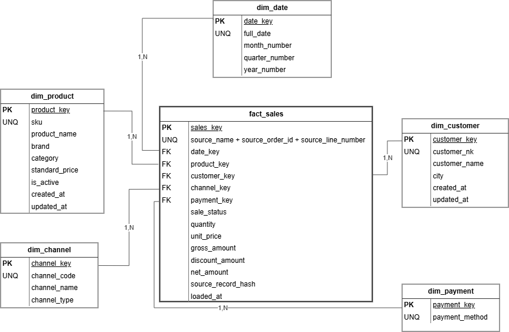
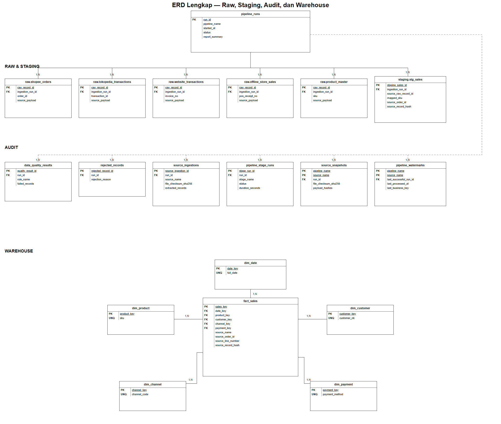
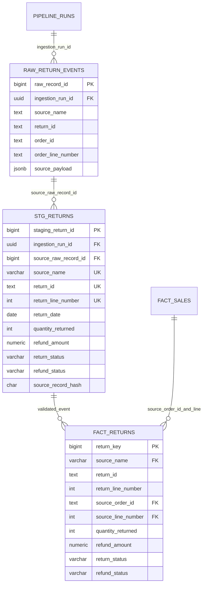

# ERD Warehouse dan Audit

Diagram berikut merangkum tabel dan relasi utama. `PK` menandai primary key, `FK` menandai foreign key, dan `UNQ` menandai unique key.

## Star Schema Warehouse

## ERD Lengkap

Diagram gambar di atas merangkum skema Raw, Staging, Audit, dan Warehouse. Relasi tambahan untuk event retur/refund ditunjukkan berikut; keduanya terpisah dari nilai penjualan.

File sumber diagram yang dapat diedit menggunakan Draw.io tersedia pada `diagrams/erd_full.drawio`.

## Analytics Views

View berikut adalah objek baca saja. View tidak ditampilkan sebagai tabel pada ERD karena tidak menyimpan data sendiri; semuanya dibentuk dari tabel Warehouse dan Audit.

| View | Sumber data utama | Kegunaan |
| --- | --- | --- |
| `warehouse.v_sales_detail` | `fact_sales`, `fact_returns`, dan seluruh dimensi terkait | Dataset transaksi untuk dashboard dan ekspor; menampilkan unit retur disetujui/diproses serta refund PROCESSED per baris penjualan. |
| `warehouse.v_sales_by_month` | `fact_sales`, `fact_returns`, `dim_date` | Penjualan per bulan/status, termasuk return unit, refund, dan net order selesai setelah refund. |
| `warehouse.v_sales_by_channel` | `fact_sales`, `fact_returns`, `dim_channel` | Penjualan per kanal/status beserta retur dan refund. |
| `warehouse.v_sales_by_product` | `fact_sales`, `fact_returns`, `dim_product` | Penjualan per produk, brand, kategori, beserta retur dan refund. |
| `warehouse.v_sales_kpi` | `fact_sales`, `fact_returns` | KPI gross/net order selesai, diskon, unit, return rate berbasis unit, refund diproses, dan AOV. |
| `warehouse.v_sales_monthly_kpi` | `fact_sales`, `fact_returns`, `dim_date` | KPI cohort order per bulan, termasuk net setelah refund dan unit return rate. |
| `warehouse.v_sales_channel_kpi` | `fact_sales`, `fact_returns`, `dim_channel` | KPI per kanal, termasuk net setelah refund dan unit return rate. |
| `warehouse.v_top_product_kpi` | `fact_sales`, `fact_returns`, `dim_product` | Dasar analisis produk berdasarkan net setelah refund, unit terjual, retur, dan refund. |
| `warehouse.v_sales_status_kpi` | `fact_sales`, `fact_returns` | Order, unit, gross/net, retur, dan refund per status transaksi. |
| `warehouse.v_return_refund_kpi` | `fact_returns` | Jumlah event retur, unit retur disetujui/diproses, dan refund PROCESSED menurut bulan retur dan kanal. |
| `warehouse.v_pipeline_quality` | `audit.pipeline_runs`, `audit.data_quality_results` | Ringkasan kualitas dan metrik setiap eksekusi pipeline. |
| `audit.v_data_quality_by_rule` | `audit.pipeline_runs`, `audit.data_quality_results` | Bukti quality check per run, source, dan aturan validasi. |
| `audit.v_data_quality_report` | `audit.pipeline_runs`, `audit.data_quality_results` | Laporan kualitas per run dan source: missing value, duplicate, invalid value, invalid date, status, serta product mapping. |

## Grain tabel

| Tabel | Grain / satu baris merepresentasikan |
| --- | --- |
| `raw.shopee_orders` | Satu baris mentah CSV Shopee dalam satu ingestion run. |
| `raw.tokopedia_transactions` | Satu baris mentah CSV Tokopedia dalam satu ingestion run. |
| `raw.website_transactions` | Satu baris mentah CSV Website dalam satu ingestion run. |
| `raw.offline_store_sales` | Satu baris mentah CSV toko offline dalam satu ingestion run. |
| `raw.product_master` | Satu baris master produk dalam satu ingestion run. |
| `raw.promo_master` | Satu definisi kode promo pada satu ingestion run. |
| `raw.order_promotions` | Tabel legacy untuk payload penggunaan promo order dari versi sumber lama; pipeline baru tidak memuat data ke tabel ini. |
| `raw.return_events` | Satu baris mentah CSV retur dalam satu ingestion run. |
| `staging.stg_sales` | Satu line item transaksi canonical yang valid. |
| `staging.stg_returns` | Satu event return yang lolos validasi dan siap dimuat ke fact. Business key: `(source_name, return_id, return_line_number)`. |
| `warehouse.fact_sales` | Satu baris item dalam satu transaksi source. Business key: `(source_name, source_order_id, source_line_number)`. |
| `warehouse.fact_returns` | Satu item dalam satu event retur. Business key: `(source_name, return_id, return_line_number)`; FK mengarah ke item `fact_sales` asal. |
| `warehouse.dim_date` | Satu tanggal kalender. |
| `warehouse.dim_product` | Satu SKU produk canonical. |
| `warehouse.dim_customer` | Satu customer natural key per source. |
| `warehouse.dim_channel` | Satu channel penjualan. |
| `warehouse.dim_payment` | Satu metode pembayaran canonical. |
| `warehouse.dim_promotion` | Satu kode promo terdefinisi. |
| `audit.pipeline_runs` | Satu eksekusi pipeline. |
| `audit.source_ingestions` | Satu file source yang diekstrak dalam satu run. |
| `audit.pipeline_stage_runs` | Satu tahap pemrosesan dalam satu run. |
| `audit.pipeline_watermarks` | Satu watermark per pipeline dan source; menyimpan run sukses terakhir, waktu proses, dan penanda pemrosesan source. |
| `audit.data_quality_results` | Satu rule kualitas per source per run. |
| `audit.rejected_records` | Satu baris transaksi yang ditolak dalam satu run. |
| `audit.source_snapshots` | Snapshot terakhir satu source untuk incremental loading. |
| `audit.source_reconciliations` | Hasil pemeriksaan snapshot lengkap dan jumlah fact yang dinonaktifkan per source/run. |

Pada staging, `source_raw_record_id` menghubungkan baris bersih dengan data raw yang menjadi asalnya. Hubungan ini dijaga oleh pipeline. Database menerapkan foreign key untuk `ingestion_run_id` dan seluruh relasi fact ke dimensi.
