# TECHNICAL PROJECT DOCUMENTATION

## Arunika Beauty Indonesia — E-Commerce Sales Data Pipeline

| Informasi Dokumen | Keterangan |
| --- | --- |
| Nama proyek | Arunika Beauty Indonesia E-Commerce Sales Data Pipeline |
| Jenis dokumen | Technical Project Documentation |
| Penyusun | Rinaldi Hamzah |
| Versi dokumen | 1.0 |
| Periode penyusunan | Oktober 2026 |
| Zona waktu sistem | Asia/Jakarta (WIB) |
| Repository | https://github.com/RinaldiHamzah/arunika-sales-pepeline-end-to-end |

Dokumen ini menjelaskan implementasi teknis proyek **Arunika Beauty Indonesia E-Commerce Sales Data Pipeline** secara menyeluruh, mulai dari data sumber hingga penyajian analitik. Penjelasan disusun berdasarkan implementasi aktual pada source code, skema PostgreSQL, konfigurasi Airflow, pengujian, dan dashboard.

Dokumen ini dirancang sebagai dokumen mandiri untuk kebutuhan penilaian dan presentasi. Nama file atau lokasi kode tetap dicantumkan sebagai evidence agar reviewer dapat mencocokkan penjelasan dengan implementasi pada repository.


### Daftar Isi

1. Project Overview
2. Data Sources
3. End-to-End Pipeline Architecture
4. Data Ingestion & Raw Layer
5. Data Quality & Validation
6. Transformation
7. Data Warehouse & Data Modeling
8. Data Dictionary
9. Incremental Loading & Duplicate Prevention
10. Logging & Monitoring
11. Airflow / Orchestration
12. SQL Analytics
13. Dashboard Analytics
14. Testing & Validation
15. Technical Stack
16. How to Run
17. Technical Decisions & Assumptions
18. Requirement Mapping
19. Conclusion

---

## 1. Project Overview

### 1.1 Background

Arunika Beauty Indonesia memiliki data penjualan yang berasal dari beberapa kanal: Shopee, Tokopedia, website perusahaan, dan toko offline. Setiap kanal menggunakan nama kolom, format tanggal, identifier, serta atribut pelanggan yang berbeda. Selain data transaksi, sistem juga memiliki Product Master sebagai referensi SKU, nama produk, brand, kategori, dan harga standar.

Jika setiap sumber dianalisis secara terpisah, laporan penjualan berisiko tidak konsisten. Satu produk dapat ditulis dengan variasi nama yang berbeda, order yang sama dapat muncul lebih dari satu kali, dan data yang tidak valid dapat ikut memengaruhi KPI bisnis.

### 1.2 Business Problem

Permasalahan yang diselesaikan oleh proyek ini adalah:

- data penjualan tersebar dalam beberapa file CSV dengan struktur berbeda;
- terdapat missing value, duplikat, quantity atau harga tidak valid, tanggal tidak dikenali, status tidak standar, dan produk yang tidak terpetakan;
- proses berulang tidak boleh memasukkan transaksi identik kembali ke Raw, Staging, atau Warehouse;
- data yang ditolak harus dapat ditelusuri sampai ke file dan baris sumber;
- laporan membutuhkan definisi KPI yang konsisten untuk gross sales, net sales, AOV, return rate, unit, dan order;
- proses harian harus dapat dijadwalkan, dipantau, diuji, dan dilaporkan.

### 1.3 Objective

Tujuan teknis proyek adalah membangun pipeline yang:

1. membaca lima sumber CSV dengan kontrak yang eksplisit;
2. menyimpan data baru atau berubah ke Raw Layer;
3. menjalankan pemeriksaan kualitas dan mengarantina data bermasalah;
4. menstandarkan transaksi lintas kanal ke satu bentuk canonical;
5. memuat data valid ke star schema PostgreSQL;
6. mencegah pemuatan ulang record identik melalui checksum, payload hash, business key, dan record hash;
7. menyediakan SQL analytics views dan dashboard analitik;
8. menyimpan audit per run dan per stage;
9. menjalankan pipeline terjadwal dengan Airflow dan mengirim laporan email;
10. menyediakan pengujian otomatis agar perubahan kode tidak merusak hasil yang sudah benar.

---

## 2. Data Sources

Semua sumber canonical berada di `data/source/`. Pipeline menggunakan allowlist sehingga file lama, hasil export, atau file lain di folder proyek tidak ikut terbaca secara tidak sengaja.

### 2.1 Ringkasan sumber

| Source | File | Grain source | Identifier utama | Format tanggal contoh | Peran |
| --- | --- | --- | --- | --- | --- |
| Shopee | `data/source/shopee.csv` | Satu transaksi/order | `order_id` | `YYYY-MM-DD` | Marketplace |
| Tokopedia | `data/source/tokopedia.csv` | Satu transaksi/order | `transaction_id` | `DD/MM/YYYY` | Marketplace |
| Website | `data/source/website.csv` | Satu invoice/order | `invoice_no` | ISO datetime | Direct channel |
| Offline Store | `data/source/offline.csv` | Satu struk POS | `pos_receipt_no` | `DD-Mon-YYYY` | Toko fisik |
| Product Master | `data/source/product.csv` | Satu SKU produk | `sku` | Tidak berlaku | Referensi produk |

### 2.2 Shopee

```csv
order_id,order_date,product_name,qty,unit_price,customer_name,customer_city,payment_method,status
SHP-0001,2026-08-20,WARDAH COLORFIT PERFECT GLOW CUSHION 13N,1,109000,Eka Wulandari,Semarang,Credit Card,cancelled
```

Mapping utama: `order_id → order_id`, `order_date → order_date`, `product_name → product_input`, `qty → quantity`, dan `unit_price → unit_price`.

### 2.3 Tokopedia

```csv
transaction_id,transaction_date,item_name,quantity,price,buyer_name,city,payment,status
TKP-0101,19/02/2026,CRYSTALLURE SUPREME REVITALIZING OIL SERUM 20ML,3,219000,Citra Lestari,Surabaya,E-Wallet,completed
```

Mapping utama: `transaction_id → order_id`, `transaction_date → order_date`, `item_name → product_input`, dan `price → unit_price`.

### 2.4 Website

```csv
invoice_no,created_at,product_identifier,quantity,unit_price,total_amount,customer_email,status
WEB-0201,2026-01-09T10:30:00,WRD-SKC-001,1,68900,68900,eka.wulandari@example.test,cancelled
```

Website menggunakan SKU pada `product_identifier`. Kolom `total_amount` divalidasi terhadap `quantity × unit_price`.

### 2.5 Offline Store

```csv
pos_receipt_no,sold_at,item_description,units,item_price,store_name,store_city,payment_type,status
POS-0301,02-May-2026,TAVI Urban Shield Sunscreen SPF 50 30ml,1,89900,Paragon Beauty Store,Jakarta,E-Wallet,returned
```

Mapping utama: `pos_receipt_no → order_id`, `sold_at → order_date`, `item_description → product_input`, `units → quantity`, dan `item_price → unit_price`.

### 2.6 Product Master

```csv
sku,product_name,brand,category,price
WRD-SKC-001,Wardah UV Shield Aqua Fresh Essence SPF 50 PA++++ 30ml,Wardah,Skincare,68900
```

Product Master menjadi sumber kebenaran untuk SKU, nama canonical, brand, kategori, dan harga referensi. Harga transaksi yang berbeda dari master tidak otomatis diganti; transaksi tetap memakai harga sumber dan selisihnya dicatat sebagai warning.

### 2.7 Baseline data contoh

File `data/processed/summary.csv` mencatat hasil validasi baseline berikut:

| Source | Baris awal | Bersih/valid | Duplikat | Ditolak |
| --- | ---: | ---: | ---: | ---: |
| Product Master | 20 | 20 | 0 | 0 |
| Shopee | 100 | 45 | 45 | 10 |
| Tokopedia | 100 | 45 | 45 | 10 |
| Website | 100 | 46 | 46 | 8 |
| Offline Store | 100 | 86 | 5 | 9 |
| **Total transaksi** | **400** | **222** | **141** | **37** |

Angka tersebut adalah baseline file contoh, bukan jumlah isi database pada setiap waktu. Jumlah database dapat bertambah setelah upload dan run berikutnya.

---

## 3. End-to-End Pipeline Architecture

### 3.1 Architecture diagram

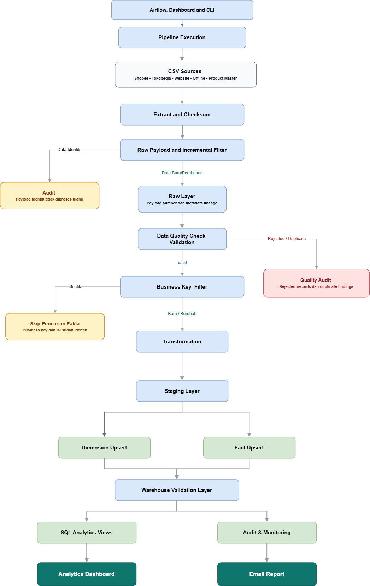

*Gambar 3.1 — Arsitektur end-to-end pipeline penjualan Arunika Beauty Indonesia.*

File sumber diagram yang dapat diedit menggunakan Draw.io tersedia pada `docs/diagrams/end_to_end_pipeline.drawio`.

### 3.2 Extract → Validate → Transform → Load

| Fase | Implementasi | Hasil |
| --- | --- | --- |
| Extract | `pipeline/extract/` membaca CSV, menghitung checksum dan payload hash, serta menyimpan nomor baris sumber. | Source frame dan metadata ingestion. |
| Incremental filter | Snapshot sukses terakhir dibandingkan dengan payload saat ini. | Hanya data baru atau berubah diteruskan. |
| Raw load | `pipeline/load/raw_loader.py` memuat nilai sumber tanpa pembersihan bisnis. | Data dapat ditelusuri sebelum validasi. |
| Validate | `pipeline/validation/data_quality.py` menerapkan kontrak dan rule kualitas. | Clean, duplicate, rejected, issues, profile, summary. |
| Warehouse incremental filter | Business key dan record hash kandidat valid dibandingkan dengan fact yang sudah tersedia. | Fact identik dilewati; hanya fact baru atau berubah yang diteruskan. |
| Transform | `pipeline/transform/standardize.py` membentuk tipe dan nama kolom canonical. | Baris staging yang konsisten. |
| Load | Loader staging, dimension, dan fact menjalankan upsert berbasis key/hash. | Star schema analytics-ready. |
| Warehouse validation | Task Airflow memeriksa konsistensi fact, business key, dan analytics view setelah loading. | Warehouse terverifikasi sebelum laporan terjadwal dikirim. |
| Publish | View SQL dan Flask menjalankan agregasi di PostgreSQL. | KPI, grafik, filter, tabel transaksi, dan export. |

Stage yang dicatat oleh runner meliputi `snapshot_lookup`, `source_scan`, `incremental_extract`, `raw_load`, `validate`, `fact_lookup`, `incremental_filter`, `transform`, `staging_load`, `dimension_load`, dan `fact_load`. Pada eksekusi terjadwal, Airflow melanjutkan proses dengan validasi warehouse dan pengiriman email. Run tanpa perubahan berhenti setelah pemeriksaan incremental Raw dan tidak menjalankan downstream stage.

---

## 4. Data Ingestion & Raw Layer

### 4.1 Proses ingestion

Pipeline dapat dijalankan melalui:

- CLI: `python -m pipeline.runner`;
- Dashboard: endpoint admin `/api/pipeline/run`;
- Airflow: task `load_pipeline`;
- upload CSV Dashboard: `/api/ingestion/upload`, dilindungi `DASHBOARD_ADMIN_TOKEN`.

Setiap file diperiksa kontrak header-nya. Pipeline menghitung checksum SHA-256 file dan hash payload per baris. Metadata ingestion disimpan di `audit.source_ingestions`, sedangkan nilai sumber disimpan pada tabel Raw yang sesuai.

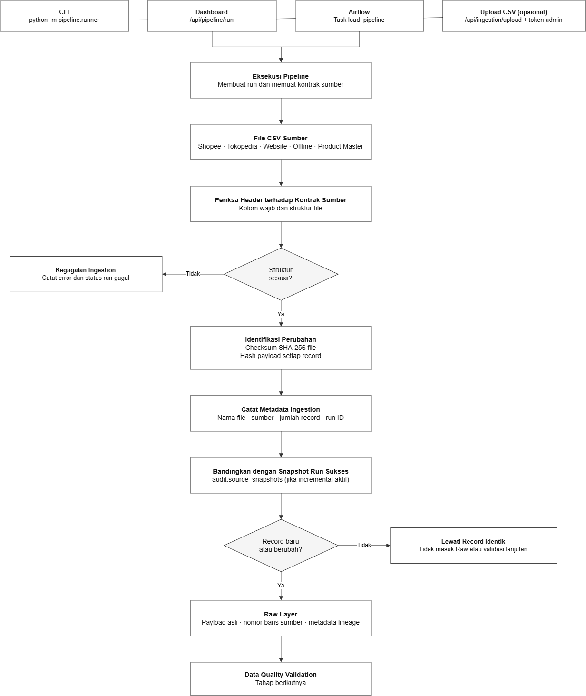

*Gambar 4.1 — Proses ingestion dari CLI, Dashboard, Airflow, atau upload CSV hingga Raw Layer.*

File sumber diagram yang dapat diedit tersedia pada `docs/diagrams/ingestion_process.drawio`.

### 4.2 Source mapping ke Raw

| Source | Tabel Raw | Kolom bisnis utama |
| --- | --- | --- |
| Shopee | `raw.shopee_orders` | `order_id`, `order_date`, `product_name`, `qty`, `unit_price` |
| Tokopedia | `raw.tokopedia_transactions` | `transaction_id`, `transaction_date`, `item_name`, `quantity`, `price` |
| Website | `raw.website_transactions` | `invoice_no`, `created_at`, `product_identifier`, `quantity`, `unit_price`, `total_amount` |
| Offline | `raw.offline_store_sales` | `pos_receipt_no`, `sold_at`, `item_description`, `units`, `item_price` |
| Product | `raw.product_master` | `sku`, `product_name`, `brand`, `category`, `price` |

Semua tabel Raw memiliki `raw_record_id`, `ingestion_run_id`, `source_file_name`, `source_row_number`, `ingested_at`, dan `source_payload`. Business ID sengaja tidak dibuat unik di Raw karena duplikat harus tetap dapat diamati sebagai bukti kualitas.

### 4.3 Memeriksa Raw Layer

```sql
SELECT 'raw.shopee_orders' AS table_name, COUNT(*) FROM raw.shopee_orders
UNION ALL SELECT 'raw.tokopedia_transactions', COUNT(*) FROM raw.tokopedia_transactions
UNION ALL SELECT 'raw.website_transactions', COUNT(*) FROM raw.website_transactions
UNION ALL SELECT 'raw.offline_store_sales', COUNT(*) FROM raw.offline_store_sales
UNION ALL SELECT 'raw.product_master', COUNT(*) FROM raw.product_master;
```

Contoh pemeriksaan lineage:

```sql
SELECT raw_record_id, ingestion_run_id, source_file_name,
       source_row_number, order_id, source_payload
FROM raw.shopee_orders
ORDER BY raw_record_id DESC
LIMIT 20;
```

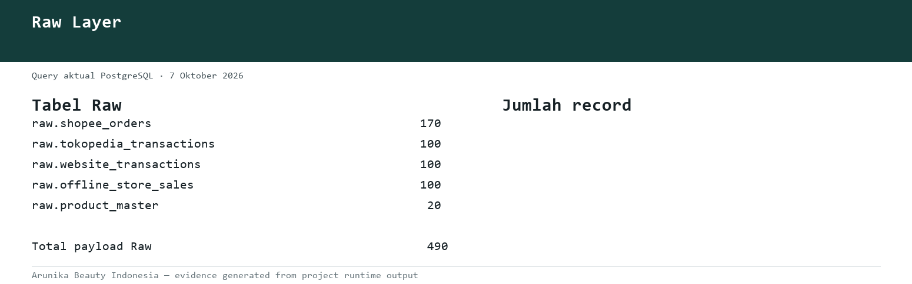

*Gambar 4.2 — Jumlah record pada setiap tabel Raw Layer berdasarkan query aktual PostgreSQL.*

---

## 5. Data Quality & Validation

### 5.1 Aturan pemeriksaan

| Pemeriksaan | Aturan | Treatment |
| --- | --- | --- |
| Missing value | Order ID, tanggal, produk, quantity, harga, dan status wajib tersedia. | Field wajib kosong membuat record ditolak; field opsional kosong menjadi `null` dan warning. |
| Duplicate | Business key sama diperiksa setelah standardisasi. | Duplikat identik: satu dipertahankan; duplikat konflik: semua versi ditolak. |
| Invalid quantity | Harus integer positif dan tidak melebihi batas PostgreSQL `INTEGER`. | Nol, negatif, pecahan, infinity, atau nonnumerik ditolak. |
| Invalid price/amount | Nilai uang harus positif dan maksimal dua desimal. | Record ditolak. |
| Website total | `total_amount = quantity × unit_price`. | Missing atau mismatch ditolak. |
| Invalid status | Hanya `COMPLETED`, `CANCELLED`, `RETURNED`. | Nilai lain ditolak. |
| Invalid date | Format harus sesuai kontrak source dan menjadi tanggal kalender valid. | Gagal parse atau tanggal tidak mungkin ditolak. |
| Data type | Identifier string, quantity integer, uang Decimal, tanggal date. | Cast failure dicatat dan record ditolak jika field wajib. |
| Product consistency | Nama/SKU dicocokkan dengan Product Master setelah normalisasi. | Produk tidak ditemukan ditolak sebagai `UNMAPPED_PRODUCT`. |
| Email | Diperiksa bila tersedia. | Email tidak valid menjadi `null` dan warning. |

Teks dinormalisasi menggunakan Unicode NFKC dan whitespace konsisten. Identifier tetap string agar leading zero tidak hilang. Nama produk mengikuti Product Master dan tidak dipaksa menggunakan `.title()`.

### 5.2 Disposisi record

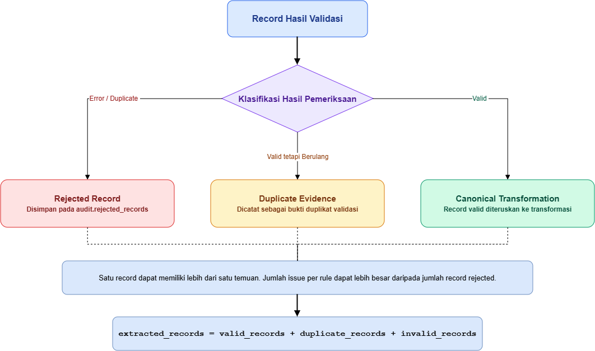

*Gambar 5.1 — Disposisi record dan rekonsiliasi hasil Data Quality Validation.*

File sumber diagram yang dapat diedit menggunakan Draw.io tersedia pada `docs/diagrams/data_quality_record_disposition.drawio`.

### 5.3 Penyimpanan bukti

- `audit.data_quality_results`: jumlah kegagalan per run, source, rule, dan severity;
- `audit.rejected_records`: payload asli, nomor baris, order ID, dan alasan penolakan;
- `audit.v_data_quality_by_rule`: detail temuan per rule;
- `audit.v_data_quality_report`: ringkasan kualitas per source;
- `data/processed/quality_issues.csv`: evidence file untuk analisis lokal.

Perintah laporan:

```powershell
.\env\Scripts\python.exe .\scripts\report_data_quality.py
.\env\Scripts\python.exe .\scripts\report_data_quality.py --run-id <UUID_RUN>
```

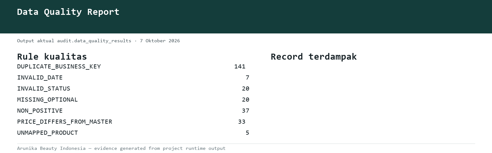

*Gambar 5.2 — Ringkasan temuan rule kualitas dari `audit.data_quality_results`.*

---

## 6. Transformation

Transformasi hanya menerima record yang lolos validasi.

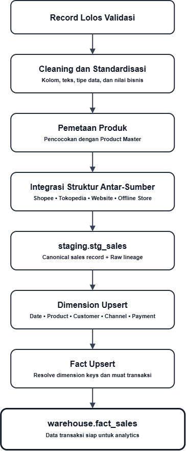

*Gambar 6.1 — Alur transformasi data dari record valid hingga Warehouse.*

File sumber diagram yang dapat diedit menggunakan Draw.io tersedia pada `docs/diagrams/transformation_to_warehouse_flow.drawio`.

### 6.1 Cleaning dan standardization

- nama kolom source dipetakan ke field canonical;
- status diubah ke uppercase dan dibatasi pada tiga nilai valid;
- tanggal source diubah ke `DATE` standar `YYYY-MM-DD`;
- quantity menjadi integer positif;
- harga dan amount menjadi `Decimal`/`NUMERIC`;
- kota dan metode pembayaran dinormalisasi melalui mapping yang terkontrol;
- customer natural key dibentuk dari identitas yang tersedia;
- `source_record_hash` dihitung untuk membedakan record identik dari koreksi.

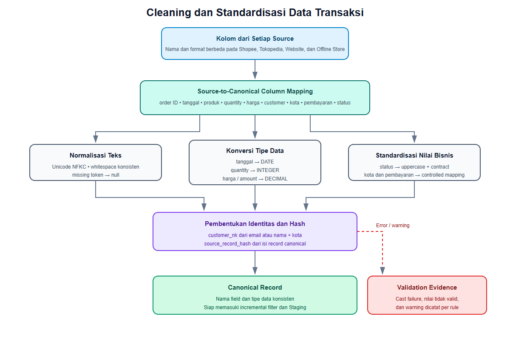

*Gambar 6.2 — Pemetaan kolom, normalisasi nilai, konversi tipe data, serta pembentukan identitas dan record hash.*

File sumber diagram yang dapat diedit menggunakan Draw.io tersedia pada `docs/diagrams/cleaning_and_standardization.drawio`.

### 6.2 Product mapping

Website umumnya menggunakan SKU, sedangkan marketplace dan offline dapat menggunakan variasi nama. Pipeline menormalisasi input produk dan mencocokkannya ke Product Master. Hasil mapping menyediakan:

```text
mapped_sku → product_name canonical → brand → category → standard_price
```

Produk yang ambigu atau tidak ditemukan tidak dipilih secara sembarang dan tidak diteruskan ke warehouse.

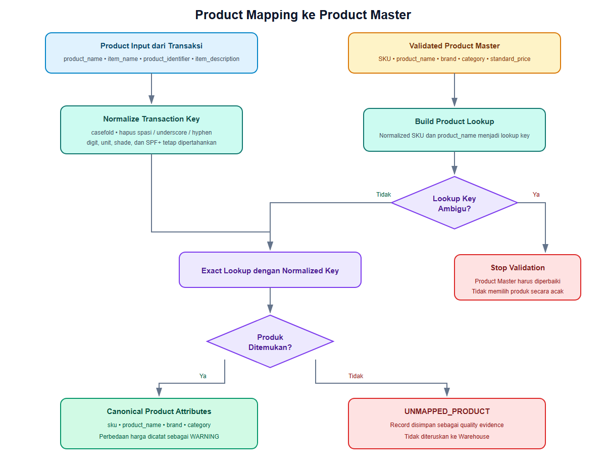

*Gambar 6.3 — Normalisasi product key dan pencocokan transaksi dengan Product Master.*

File sumber diagram yang dapat diedit menggunakan Draw.io tersedia pada `docs/diagrams/product_mapping_flow.drawio`.

### 6.3 Penyatuan Data Antar-Sumber

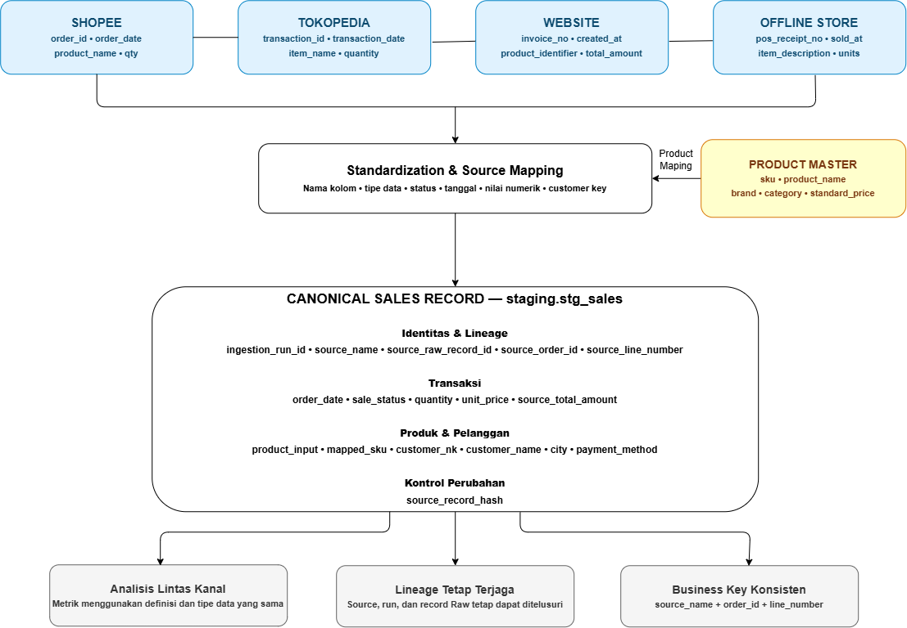

*Gambar 6.4 — Penyatuan struktur transaksi Shopee, Tokopedia, Website, dan Offline Store menjadi canonical sales record.*

File sumber diagram yang dapat diedit menggunakan Draw.io tersedia pada `docs/diagrams/cross_source_data_integration.drawio`.

### 6.4 Pemuatan ke Staging

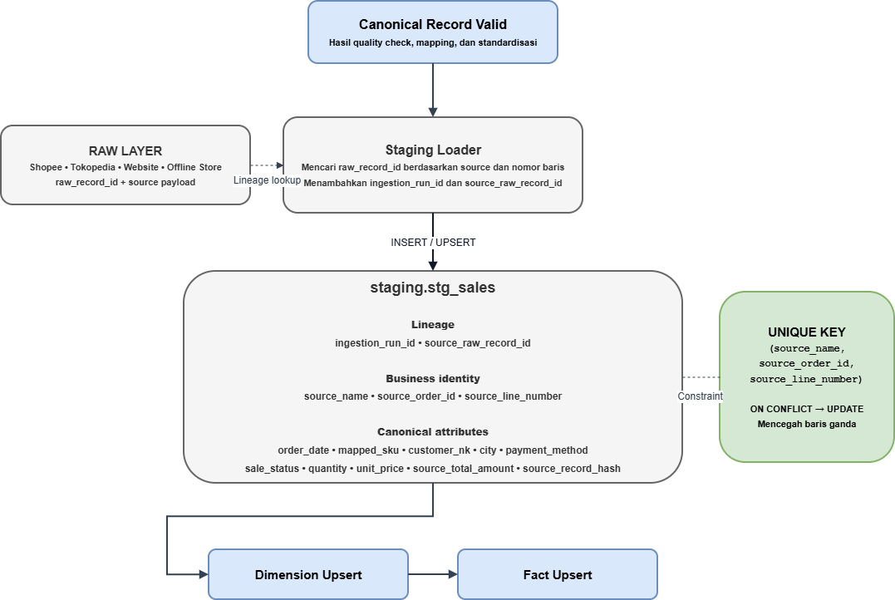

*Gambar 6.5 — Pemuatan canonical record ke `staging.stg_sales`, pemeliharaan Raw lineage, dan pencegahan baris ganda.*

File sumber diagram yang dapat diedit menggunakan Draw.io tersedia pada `docs/diagrams/staging_load_flow.drawio`.

---

## 7. Data Warehouse & Data Modeling

### 7.1 Warehouse architecture

Warehouse menggunakan **star schema** karena kebutuhan utama sistem adalah agregasi analitik berdasarkan waktu, produk, channel, customer, dan pembayaran.

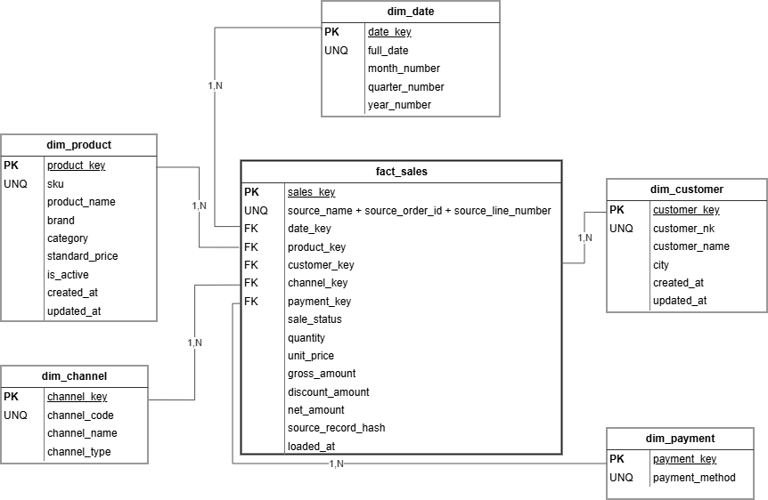

*Gambar 7.1 — Star schema Warehouse dengan `fact_sales` sebagai pusat analitik.*

File sumber diagram yang dapat diedit menggunakan Draw.io tersedia pada `docs/diagrams/erd.drawio`.

ERD lengkap, termasuk Raw dan Audit, tersedia pada `docs/erd.md` dan dapat diperiksa melalui repository proyek.

### 7.2 Grain, PK, FK, dan alasan desain

| Tabel | Grain | Primary/unique key | Foreign key | Alasan |
| --- | --- | --- | --- | --- |
| `fact_sales` | Satu produk dalam satu transaksi source | `sales_key`; UK `(source_name, source_order_id, source_line_number)` | Seluruh dimension key | Pusat measurement penjualan dan idempotensi lintas kanal. |
| `dim_date` | Satu tanggal | `date_key`; `full_date` unique | — | Analisis waktu tanpa parsing tanggal berulang. |
| `dim_product` | Satu SKU canonical | `product_key`; `sku` unique | — | Konsistensi produk, brand, kategori, dan harga referensi. |
| `dim_customer` | Satu natural key customer | `customer_key`; `customer_nk` unique | — | Analisis customer/kota meskipun atribut source berbeda. |
| `dim_channel` | Satu kanal | `channel_key`; `channel_code` unique | — | Perbandingan marketplace, direct, dan offline. |
| `dim_payment` | Satu metode pembayaran | `payment_key`; `payment_method` unique | — | Analisis metode pembayaran tanpa duplikasi teks. |

Surrogate key menjaga fact tetap ringkas dan stabil. Business key sumber tetap disimpan agar transaksi dapat dilacak dan di-upsert. Dimensi customer dan payment bersifat nullable karena tidak seluruh source menyediakan atribut tersebut.

---

## 8. Data Dictionary

Kamus data lengkap berada pada `docs/data_dictionary.md`. Ringkasan field inti ditampilkan berikut agar dokumen ini tetap dapat dibaca secara mandiri.

### 8.1 Raw Layer

| Field | Tipe | Key | Deskripsi |
| --- | --- | --- | --- |
| `raw_record_id` | BIGINT | PK | Identitas baris Raw. |
| `ingestion_run_id` | UUID | FK → `audit.pipeline_runs` | Run yang memasukkan record. |
| `source_file_name` | TEXT | UK gabungan | Nama file sumber. |
| `source_row_number` | INTEGER | UK gabungan | Nomor baris CSV untuk lineage. |
| `ingested_at` | TIMESTAMPTZ | — | Waktu ingestion. |
| Source-specific fields | TEXT | — | Nilai asli sebelum cast/cleaning. |
| `source_payload` | JSONB | — | Payload lengkap sumber. |

### 8.2 Staging

| Field | Tipe | Key | Deskripsi |
| --- | --- | --- | --- |
| `staging_sales_id` | BIGINT | PK | Identitas staging. |
| `ingestion_run_id` | UUID | FK | Run transformasi. |
| `source_name`, `source_order_id`, `source_line_number` | VARCHAR/TEXT/INTEGER | UK gabungan | Business key canonical. |
| `source_raw_record_id` | BIGINT | Lineage | ID baris Raw asal. |
| `order_date` | DATE | — | Tanggal canonical. |
| `product_input`, `mapped_sku` | TEXT/VARCHAR | — | Input produk dan hasil mapping. |
| `customer_nk`, `customer_name`, `city` | TEXT | — | Atribut customer canonical. |
| `payment_method`, `sale_status` | VARCHAR | — | Pembayaran dan status canonical. |
| `quantity` | INTEGER | — | Unit tervalidasi. |
| `unit_price`, `gross_amount`, `source_total_amount` | NUMERIC | — | Nilai transaksi. |
| `source_record_hash` | CHAR(64) | — | Deteksi perubahan record. |
| `is_valid`, `validation_notes` | BOOLEAN/JSONB | — | Status dan catatan validasi. |

### 8.3 Fact dan dimensions

| Tabel.Field | Tipe | Key | Deskripsi |
| --- | --- | --- | --- |
| `fact_sales.sales_key` | BIGINT | PK | Surrogate key fact. |
| `fact_sales.date_key` | INTEGER | FK | Relasi tanggal. |
| `fact_sales.product_key` | BIGINT | FK | Relasi produk. |
| `fact_sales.customer_key` | BIGINT | FK nullable | Relasi customer. |
| `fact_sales.channel_key` | SMALLINT | FK | Relasi channel. |
| `fact_sales.payment_key` | SMALLINT | FK nullable | Relasi pembayaran. |
| `fact_sales.sale_status` | VARCHAR(20) | — | Status order. |
| `fact_sales.quantity` | INTEGER | — | Unit transaksi. |
| `fact_sales.unit_price` | NUMERIC(14,2) | — | Harga satuan source. |
| `fact_sales.gross_amount` | NUMERIC(16,2) | — | `quantity × unit_price`. |
| `fact_sales.discount_amount` | NUMERIC(16,2) | — | Diskon; baseline source belum memilikinya. |
| `fact_sales.net_amount` | NUMERIC(16,2) | — | Gross dikurangi diskon. |
| `fact_sales.source_record_hash` | CHAR(64) | — | Deteksi koreksi/idempotensi. |
| `dim_date.date_key` | INTEGER | PK | Tanggal format `YYYYMMDD`. |
| `dim_product.product_key`, `sku` | BIGINT/VARCHAR | PK/UK | Identitas produk canonical. |
| `dim_customer.customer_key`, `customer_nk` | BIGINT/TEXT | PK/UK | Identitas customer canonical. |
| `dim_channel.channel_key`, `channel_code` | SMALLINT/VARCHAR | PK/UK | Identitas channel. |
| `dim_payment.payment_key`, `payment_method` | SMALLINT/VARCHAR | PK/UK | Identitas pembayaran. |

### 8.4 Audit

| Tabel | Grain | Field penting |
| --- | --- | --- |
| `pipeline_runs` | Satu eksekusi pipeline | Run ID, status, start/end, seluruh metrik, error, summary. |
| `pipeline_stage_runs` | Satu stage pada satu run | Stage, status, durasi, records processed, error. |
| `source_ingestions` | Satu source pada satu run | File, path, checksum, format, extracted records. |
| `source_snapshots` | Snapshot terakhir per source | File checksum, payload hashes, source records, run ID. |
| `pipeline_watermarks` | Satu source per pipeline | Run sukses terakhir, waktu proses, business key. |
| `data_quality_results` | Satu rule/source/run | Severity, failed records, details. |
| `rejected_records` | Satu record ditolak | Source, order, row, reason, payload. |

---

## 9. Incremental Loading & Duplicate Prevention

### 9.1 Mekanisme incremental

1. File dihitung checksum SHA-256.
2. Payload setiap baris dinormalisasi untuk menghasilkan hash.
3. Hash dibandingkan dengan `audit.source_snapshots` dari run sukses terakhir.
4. Payload identik dilewati sebelum Raw dan quality check.
5. Kandidat valid dibandingkan hanya dengan business key fact yang relevan.
6. Key baru di-insert; key sama dengan hash berbeda di-upsert sebagai koreksi; key dan hash sama tidak ditulis ulang.

Business key fact:

```text
(source_name, source_order_id, source_line_number)
```

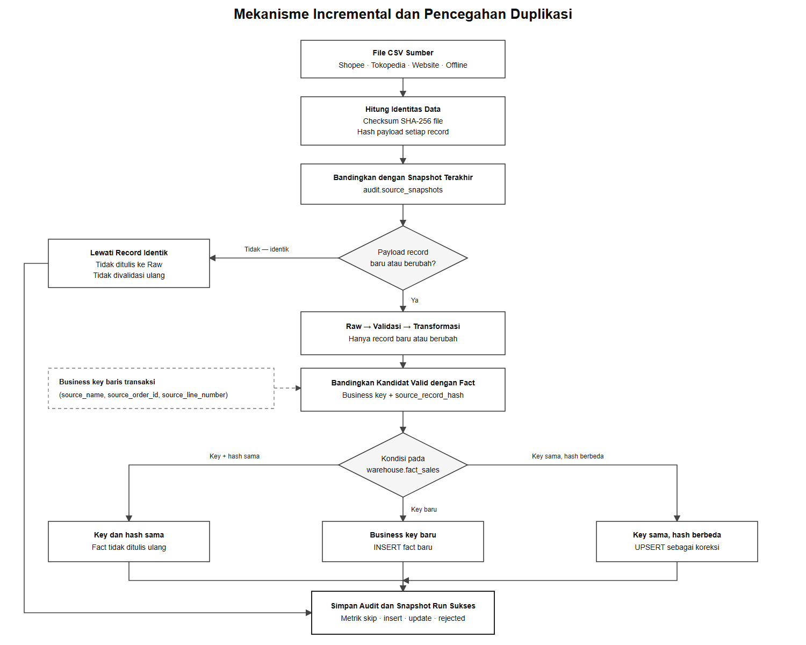

**Gambar 9.1 — Mekanisme incremental dari pemeriksaan checksum dan snapshot hingga keputusan INSERT, skip, atau UPSERT pada Warehouse.**

File sumber diagram yang dapat diedit menggunakan Draw.io tersedia pada `docs/diagrams/incremental_loading_flow.drawio`.

### 9.2 Contoh perbandingan run

Bagian ini menggunakan hasil aktual audit, bukan angka ilustratif. Run dengan perubahan memproses 70 kandidat dari 470 record source. Run berikutnya tanpa perubahan melewati seluruh 470 record sebelum tahap downstream.

Query bukti aktual:

```sql
SELECT run_id, started_at, status, source_records,
       skipped_unchanged_records, extracted_records,
       validated_records, rejected_records,
       duplicate_records, loaded_records, outcome_message
FROM audit.pipeline_runs
ORDER BY started_at ASC;
```

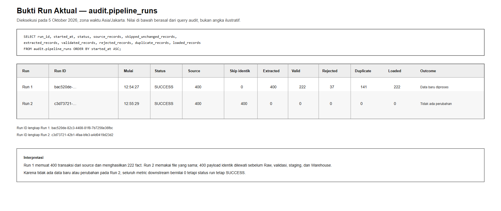

**Gambar 9.2 — Output aktual `audit.pipeline_runs` untuk run dengan perubahan dan run tanpa perubahan.**

| Metrik | Run dengan perubahan — `31a3b0e5` | Run tanpa perubahan — `a6a9f315` | Interpretasi |
| --- | ---: | ---: | --- |
| Record pada source | 470 | 470 | Kedua run membaca snapshot source yang sama. |
| Record identik dilewati | 400 | 470 | Pada run tanpa perubahan seluruh payload tersedia pada snapshot sukses sebelumnya. |
| Kandidat baru atau berubah | 70 | 0 | Hanya run dengan perubahan meneruskan data ke tahap downstream. |
| Data valid | 46 | 0 | Validasi tidak dijalankan ulang untuk payload identik. |
| Data ditolak | 24 | 0 | Tidak ada pemeriksaan baru pada run tanpa perubahan. |
| Fact dimuat | 46 | 0 | Tidak ada fact ditulis ulang ketika isi source identik. |
| Status | `SUCCESS` | `SUCCESS` | Run tanpa perubahan tetap selesai dengan sukses. |

Hasil ini menunjukkan bahwa strategi incremental bekerja pada dua tingkat: payload identik dilewati sebelum Raw Layer dan validasi, sedangkan kandidat yang valid hanya akan ditulis ke fact apabila business key atau isi record membutuhkan perubahan.

Penanganan record:

| Kondisi | Tindakan |
| --- | --- |
| Payload identik dengan snapshot | Skip sebelum Raw. |
| Payload baru | Raw → Validate → Staging → Warehouse. |
| Business key sama, hash berbeda | Koreksi/upsert. |
| Business key dan hash sama | Fact tidak ditulis ulang. |
| Duplikat dalam kandidat validasi | Dicatat sebagai duplicate. |
| Business key sama dengan isi konflik | Semua versi dikarantina. |
| Baris hilang dari source | Tidak dihapus otomatis dari warehouse. |

---

## 10. Logging & Monitoring

### 10.1 Informasi yang dicatat

`audit.pipeline_runs` menyimpan:

- `run_id`, pipeline name, orchestration run ID;
- start time, end time, duration, status, current stage;
- source, extracted, valid, rejected, duplicate, incremental, staged, dimension, fact, dan loaded records;
- skipped unchanged dan fact skipped;
- error message, outcome message, source metrics, dan report summary.

`audit.pipeline_stage_runs` menyimpan durasi dan status setiap stage. Log aplikasi tersedia pada `logs/pipeline.log` dan `logs/dashboard.log` dengan timestamp WIB. Untuk runtime Docker, log juga dapat dibaca melalui `docker compose logs`.

### 10.2 Error handling

- exception pipeline mengubah run menjadi `FAILED` dan menyimpan `error_message`;
- stage yang gagal dicatat terpisah;
- transaction database melindungi pemuatan Staging/Dimension/Fact;
- lock pipeline mencegah dua run aktif menulis bersamaan;
- SMTP memiliki bounded retry;
- kegagalan email Airflow membuat task `email_pipeline_report` berstatus `failed`, sehingga tidak tampil sebagai sukses palsu.

### 10.3 Perintah monitoring

```powershell
.\env\Scripts\python.exe .\scripts\monitor_pipeline.py
.\env\Scripts\python.exe .\scripts\monitor_pipeline.py --follow 10
.\env\Scripts\python.exe .\scripts\check_freshness.py
.\env\Scripts\python.exe .\scripts\check_warehouse.py
```

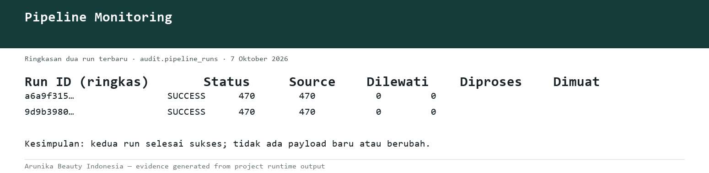

*Gambar 10.1 — Ringkasan status dan volume dua pipeline run terbaru dari `audit.pipeline_runs`.*

---

## 11. Airflow / Orchestration

### 11.1 DAG dan schedule

DAG bernama `ecommerce_sales_pipeline` berada di `airflow/orchestration.py` dan dijadwalkan setiap hari pukul **13.00 WIB**:

```text
0 13 * * *
```

Konfigurasi utama:

- timezone: `Asia/Jakarta`;
- `catchup=False`;
- `max_active_runs=1`;
- retry: 2 kali;
- retry delay: 5 menit.

### 11.2 Task flow

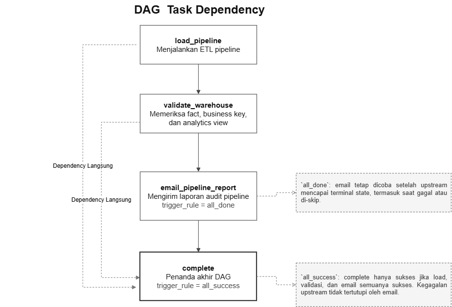

**Gambar 11.1 — Urutan task dan dependency pada DAG `ecommerce_sales_pipeline`.**

File sumber diagram yang dapat diedit menggunakan Draw.io tersedia pada `docs/diagrams/airflow_task_dependency.drawio`.

`email_pipeline_report` memakai `trigger_rule="all_done"` agar laporan tetap dicoba setelah terminal state. Task `complete` memakai `all_success`, sehingga kegagalan loading, warehouse validation, atau email tetap terlihat sebagai kegagalan DAG.

### 11.3 Retry dan failure handling

Jika SMTP gagal, `send_pipeline_report` mengembalikan `False`; wrapper Airflow kemudian melempar `RuntimeError`. Airflow menandai task gagal dan menjalankan retry sesuai konfigurasi. Log menyimpan host, port, attempt, max attempts, dan error message tanpa mencatat password.


*Gambar 11.2 — Dependency task pada Airflow DAG berdasarkan implementasi `airflow/orchestration.py`.*


---

## 12. SQL Analytics

### 12.1 Analytics views

| View | Output utama |
| --- | --- |
| `warehouse.v_sales_detail` | Detail transaksi canonical beserta seluruh dimensi. |
| `warehouse.v_sales_kpi` | Gross, net, total/completed/returned order, unit, return rate, AOV. |
| `warehouse.v_sales_monthly_kpi` | KPI per bulan. |
| `warehouse.v_sales_channel_kpi` | KPI per channel. |
| `warehouse.v_top_product_kpi` | Revenue, unit, dan order per produk. |
| `warehouse.v_sales_status_kpi` | Order, unit, gross, dan net per status. |
| `audit.v_data_quality_by_rule` | Temuan per rule/source/run. |
| `audit.v_data_quality_report` | Ringkasan kualitas per source/run. |

### 12.2 Definisi KPI

- **Gross sales:** seluruh `gross_amount` untuk semua status.
- **Net sales:** `net_amount` hanya untuk status `COMPLETED`.
- **Completed orders:** distinct `(source_name, source_order_id)` dengan status `COMPLETED`.
- **Units sold:** quantity dari transaksi `COMPLETED`.
- **Return rate:** returned orders ÷ seluruh orders × 100%.
- **AOV:** net sales completed ÷ completed orders.

### 12.3 Query dan output

```sql
-- KPI utama
SELECT * FROM warehouse.v_sales_kpi;

-- Sales per month
SELECT *
FROM warehouse.v_sales_monthly_kpi
ORDER BY month_start;

-- Sales by channel
SELECT *
FROM warehouse.v_sales_channel_kpi
ORDER BY net_sales_completed DESC;

-- Top product
SELECT *
FROM warehouse.v_top_product_kpi
ORDER BY net_sales_completed DESC
LIMIT 10;

-- Sales by status
SELECT *
FROM warehouse.v_sales_status_kpi
ORDER BY sale_status;
```

Hasil aktual mengikuti isi warehouse pada saat query dijalankan. Definisi SQL dapat diperiksa pada `database/schema/8_analytics_views.sql`.

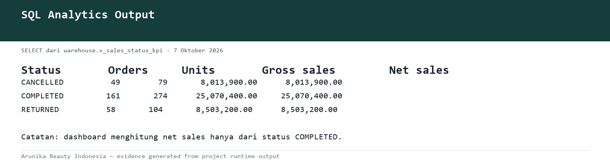

*Gambar 12.1 — Output aktual `warehouse.v_sales_status_kpi`.*

---

## 13. Dashboard Analytics

Dashboard Flask membaca `warehouse.v_sales_detail` dan menjalankan agregasi SQL dengan parameter terikat. Filter tersedia untuk periode, channel, status, kategori, brand, dan produk/SKU.

### 13.1 KPI dan visualisasi

- Penjualan Bersih;
- Penjualan Kotor;
- Pesanan Selesai;
- Unit Terjual;
- Average Order Value;
- Tingkat Retur;
- tren Gross vs Net per bulan;
- kontribusi penjualan per channel;
- status pesanan;
- top cities;
- top brands, categories, SKU, dan products;
- rincian transaksi dan export CSV;
- status serta riwayat pipeline pada halaman Pengaturan.

### 13.2 Business questions

Dashboard dapat menjawab:

- bagaimana tren penjualan gross dan net dari bulan ke bulan;
- kanal mana yang memberikan net sales terbesar;
- produk, SKU, brand, dan kategori mana yang paling kuat;
- berapa AOV transaksi completed;
- berapa tingkat retur dan distribusi status order;
- kota mana yang menghasilkan penjualan completed terbesar;
- bagaimana kualitas dan status run pipeline terakhir.

### 13.3 Screenshot Dashboard

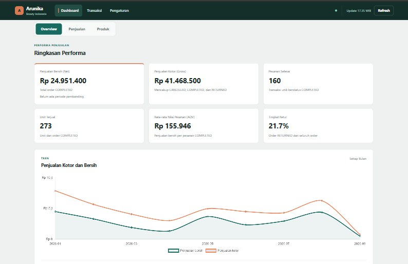

*Gambar 13.1 — Dashboard ringkasan KPI dan performa penjualan.*

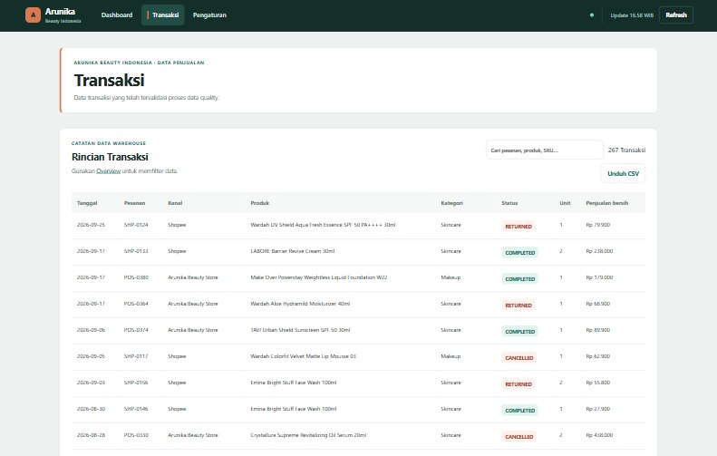

*Gambar 13.2 — Halaman rincian transaksi yang telah tervalidasi.*

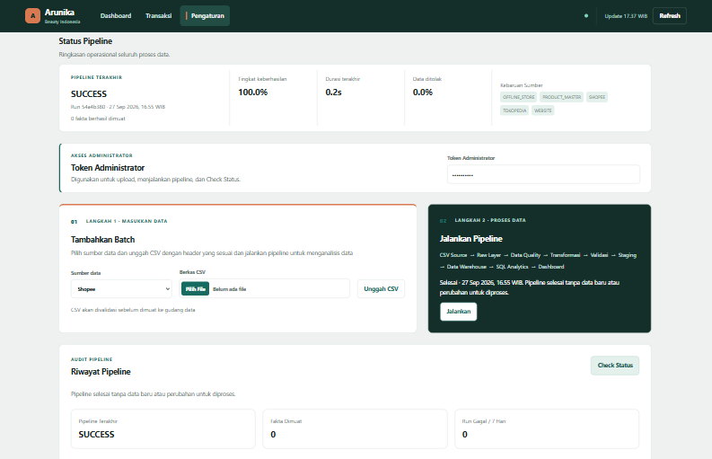

*Gambar 13.3 — Halaman pengaturan, eksekusi, dan audit pipeline.*

---

## 14. Testing & Validation

### 14.1 Jenis pengujian

| Jenis | Implementasi |
| --- | --- |
| Unit test | Aturan quality, contract, transformasi, report, alert, incremental, dan ingestion. |
| Data quality test | Missing, duplicate, conflict, quantity, money, date, product mapping, schema CSV. |
| Integration test | PostgreSQL test terisolasi melalui Docker Compose. |
| SQL validation | Safety check seluruh schema; opsi `--database` menguji eksekusi schema. |
| Clean contract | Memastikan hasil export memiliki file dan struktur yang benar. |
| Browser smoke test | Navigasi, responsive viewport, chart fallback, filter, pagination UI, upload, run, dan riwayat. |
| Lint | Ruff memeriksa style dan import Python. |
| CI | GitHub Actions menjalankan lint, test, migration, smoke test, dan Docker build. |

### 14.2 Perintah

```powershell
# Unit dan application test
.\env\Scripts\python.exe .\tests\main.py

# Seluruh test termasuk PostgreSQL dan browser
.\env\Scripts\python.exe .\tests\main.py --full

# Quality-specific
.\env\Scripts\python.exe -m pytest tests/test_data_quality.py -q

# Lint
.\env\Scripts\python.exe -m ruff check .
```

Pemeriksaan terakhir pada 3 Oktober 2026 mengumpulkan 49 test non-integration dan seluruhnya lulus; 1 integration test tidak dijalankan karena Docker Engine sedang tidak aktif.

> **TEMPAT GAMBAR 14.1 — Hasil Pengujian**  
> Jalankan `tests/main.py --full` pada environment dengan Docker aktif. Caption final: *Gambar 14.1 — Hasil unit test, integration test, dan browser smoke test.*

---

## 15. Technical Stack

| Komponen | Teknologi | Fungsi |
| --- | --- | --- |
| Bahasa | Python 3.12 | ETL, validation, API, scripts, orchestration callable. |
| Data processing | pandas | Pembacaan, profiling, validasi, dan transformasi source. |
| Database | PostgreSQL 16 | Raw, Staging, Warehouse, Audit, analytics views. |
| Database access | SQLAlchemy 2, psycopg, asyncpg | Connection dan query database. |
| Migration | Alembic | Upgrade schema database yang sudah berjalan. |
| Orchestration | Apache Airflow 3.3.1 | Jadwal, dependency, retry, monitoring task. |
| Backend dashboard | Flask + Waitress | API dan penyajian dashboard. |
| Frontend | HTML, CSS, JavaScript, Chart.js | UI, filter, chart, transaksi, pengaturan. |
| Container | Docker & Docker Compose | Menjalankan PostgreSQL, pipeline, dashboard, Airflow, pgAdmin, dan test DB. |
| Testing | pytest, pytest-cov, browser smoke test | Unit, integration, coverage, dan UI verification. |
| Code quality | Ruff, pre-commit | Lint dan konsistensi kode. |
| CI/CD | GitHub Actions, GHCR | Test otomatis, build, dan publish image. |
| Analysis | Jupyter/IPython, Plotly | Eksplorasi source dan quality evidence. |
| Optional tunnel | ngrok | Membagikan dashboard lokal sementara. |

### 14.2 Hasil pengujian terkini

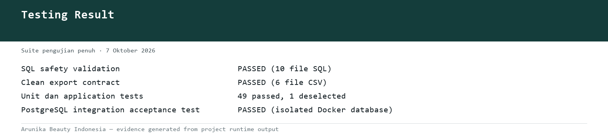

*Gambar 14.1 — Hasil pengujian SQL safety, clean contract, unit/application test, dan integration test PostgreSQL terisolasi.*

---

## 16. How to Run

### 16.1 Persiapan

```powershell
Copy-Item .env.example .env
```

Isi secret pada `.env`, terutama `POSTGRES_PASSWORD`, `DASHBOARD_ADMIN_TOKEN`, Airflow keys/password, dan SMTP bila email digunakan. Jangan commit `.env`.

### 16.2 Menjalankan seluruh service

```powershell
docker compose up -d --build
docker compose ps
```

Endpoint utama:

```text
Dashboard : http://127.0.0.1:8501
Airflow   : http://127.0.0.1:8080
PostgreSQL: 127.0.0.1:5433
pgAdmin   : profile tools, port 5050
```

### 16.3 Menjalankan pipeline manual

```powershell
.\env\Scripts\python.exe -m pipeline.runner
.\env\Scripts\python.exe .\scripts\check_warehouse.py
```

### 16.4 Migration

```powershell
.\env\Scripts\python.exe -m alembic current
.\env\Scripts\python.exe -m alembic upgrade head
```

### 16.5 Mematikan service

```powershell
docker compose down
```

Perintah ini tidak menghapus volume. Jangan menggunakan opsi `-v` bila data PostgreSQL masih diperlukan.

---

## 17. Technical Decisions & Assumptions

### 17.1 Alasan pemilihan teknologi

- **PostgreSQL:** mendukung transaksi, constraint, JSONB, analytical SQL, view, dan schema terpisah.
- **Python/pandas:** cocok untuk source CSV heterogen dan rule validasi eksplisit.
- **Airflow:** memberikan schedule, retry, task dependency, dan riwayat eksekusi.
- **Flask:** ringan untuk dashboard internal dan mudah diintegrasikan dengan query SQL.
- **Docker Compose:** membuat environment lokal reproducible tanpa instalasi service satu per satu.
- **Alembic:** memperbarui database berisi data tanpa menghapus volume.

### 17.2 Alasan data modeling

Star schema dipilih karena kebutuhan utama berupa agregasi berulang berdasarkan tanggal, produk, customer, channel, dan payment. Fact menyimpan measurement, sedangkan dimensi menyimpan konteks. Model ini sederhana untuk query BI dan menjaga definisi atribut tetap konsisten.

### 17.3 Incremental strategy

Checksum file mempercepat deteksi source tidak berubah, payload hash menentukan baris baru/berubah, dan business key plus record hash melindungi Warehouse dari duplicate write. Lookup fact dibatasi pada key kandidat run, bukan membaca seluruh fact ke memori.

### 17.4 Asumsi

- grain transaksi source saat ini satu produk per order dan `source_line_number = 1`;
- order ID hanya unik di dalam source, sehingga source menjadi bagian business key;
- source belum menyediakan diskon; `discount_amount = 0`;
- `COMPLETED` digunakan untuk net sales dan unit terjual;
- gross sales mencakup semua status;
- transaksi yang hilang dari file tidak otomatis dihapus;
- late-arriving transaction tetap memakai tanggal bisnis transaksinya;
- field customer/payment boleh nullable bila source tidak menyediakan;
- data CSV repository adalah data simulasi, bukan transaksi atau harga resmi perusahaan.

---

## 18. Requirement Mapping

Tabel berikut memetakan kriteria yang diberikan ke implementasi dan evidence repository. Karena dokumen PDF sumber tidak tersedia di repository, kolom requirement menggunakan deskripsi kriteria yang diberikan untuk proyek ini.

| No. | Requirement | Implementasi | Evidence |
| ---: | --- | --- | --- |
| 1 | Project overview, problem, objective | Latar belakang multi-source dan sasaran pipeline | Bagian 1; `README.md` |
| 2 | Lima data source dan contoh struktur | Kontrak eksplisit untuk Shopee, Tokopedia, Website, Offline, Product | Bagian 2; `data/source/`; `pipeline/validation/contracts.py` |
| 3 | End-to-end architecture | Extract, incremental, Raw, DQ, transform, staging, warehouse, views, dashboard | Bagian 3; `docs/architecture.md`; `pipeline/runner.py` |
| 4 | Ingestion dan Raw Layer | Source allowlist, checksum, raw tables, payload dan lineage | Bagian 4; `pipeline/extract/`; `pipeline/load/raw_loader.py`; `database/schema/3_raw_tables.sql` |
| 5 | Data quality lengkap | Missing, duplicate, quantity, price, status, date, type, mapping | Bagian 5; `pipeline/validation/`; `docs/data_quality.md` |
| 6 | Transformation lintas source | Canonical mapping dan typed staging rows | Bagian 6; `pipeline/transform/standardize.py` |
| 7 | Warehouse dan star schema | Fact sales dan lima dimensi dengan PK/FK | Bagian 7; `database/schema/5_dimensions.sql`; `6_fact_tables.sql`; `docs/erd.md` |
| 8 | Data dictionary | Tabel, field, type, key, description | Bagian 8; `docs/data_dictionary.md` |
| 9 | Incremental dan duplicate prevention | Checksum, snapshot, payload hash, business key, record hash | Bagian 9; `audit.source_snapshots`; incremental tests |
| 10 | Logging dan monitoring | Run/stage audit, metrics, error, logs, scripts | Bagian 10; `audit.pipeline_runs`; `pipeline/logger.py`; `scripts/monitor_pipeline.py` |
| 11 | Airflow orchestration | DAG harian 13.00 WIB, dependency, retry, failure | Bagian 11; `airflow/orchestration.py` |
| 12 | SQL analytics | KPI, month, channel, product, status views | Bagian 12; `database/schema/8_analytics_views.sql` |
| 13 | Dashboard analytics | KPI, charts, filters, transaction detail, audit | Bagian 13; `dashboard/`; `docs/images/` |
| 14 | Testing dan validation | Unit, integration, SQL, contract, browser, CI | Bagian 14; `tests/`; `.github/workflows/ci.yml` |
| 15 | Technical stack | Python, PostgreSQL, Airflow, Docker, Flask, JS | Bagian 15; `requirements.txt`; `docker-compose.yml` |
| 16 | How to run | Environment, Docker, manual pipeline, migration | Bagian 16; `README.md`; `docs/technical_runbook.md` |
| 17 | Decisions dan assumptions | Technology, modeling, incremental, business assumptions | Bagian 17; `README.md`; `docs/architecture.md` |
| 18 | Requirement mapping | Requirement-to-code evidence matrix | Bagian 18 ini |
| 19 | Conclusion | Ringkasan kesiapan pipeline dan analytics | Bagian 19 |

### Evidence visual yang tersedia

| Bukti | File | Sumber bukti |
| --- | --- | --- |
| Raw Layer | [raw-layer.png](images/raw-layer.png) | Query tabel Raw melalui PostgreSQL. |
| Data Quality | [data-quality-report.png](images/data-quality-report.png) | Output `audit.data_quality_results`. |
| Incremental Run | [incremental-runs.png](images/incremental-runs.png) | Query `audit.pipeline_runs`. |
| Monitoring | [pipeline-monitoring.png](images/pipeline-monitoring.png) | Ringkasan `audit.pipeline_runs`. |
| Airflow | [airflow-dag.png](images/airflow-dag.png) | Diagram dependency dari DAG source code. |
| SQL analytics | [sql-analytics-output.png](images/sql-analytics-output.png) | Query `warehouse.v_sales_status_kpi`. |
| Testing | [testing-result.png](images/testing-result.png) | `tests/main.py --full`. |

---

## 19. Conclusion

Proyek ini telah membentuk pipeline data penjualan end-to-end yang dapat ditelusuri dari CSV sampai dashboard. Data heterogen dari empat kanal penjualan dan Product Master diperiksa dengan kontrak yang jelas, perubahan disimpan di Raw Layer, record bermasalah dipisahkan sebagai evidence, dan transaksi valid disatukan ke struktur canonical.

Warehouse menggunakan star schema yang analytics-ready. PostgreSQL menyediakan view untuk KPI, penjualan bulanan, channel, produk, dan status. Dashboard menggunakan definisi bisnis yang sama untuk menampilkan gross sales, net sales, AOV, return rate, unit, tren, serta ranking produk dan channel.

Pipeline bersifat incremental dan idempotent: data identik tidak dimuat ulang, data baru diproses, dan koreksi dikenali melalui business key serta hash. Audit per run dan per stage, Airflow, retry, email report, log, dan test otomatis menyediakan kontrol operasional yang dibutuhkan untuk menjalankan sistem secara konsisten.

Dengan demikian, tujuan utama proyek telah terpenuhi: **pipeline end-to-end berjalan, data telah melalui quality control, warehouse siap dianalisis, dan hasil analitik tersedia melalui SQL maupun dashboard**. Bukti query dan pengujian terkini telah disimpan di `docs/images/`; screenshot Grid atau Graph View Airflow dapat ditambahkan bila diperlukan sebagai bukti operasional UI.

---
